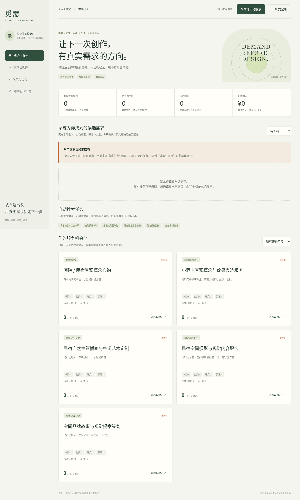

# 觅需 · 自动寻找设计服务需求

面向国内中文市场的个人景观与视觉设计需求雷达。**启动程序 → 系统自动搜索 → 首页查看候选需求 → 核对原文并决定跟进。** 手动记录只是补充，不是使用前提。



## Windows 开始使用

需要 Python 3.12 或更新版本，无第三方运行依赖。

1. 下载本分支 ZIP 并“全部解压”，打开 `demand-radar`。
2. 双击 `start-windows.bat`，保留命令窗口。
3. 浏览器打开 `http://127.0.0.1:8765`，等待第一次自动搜索，或点击“立即自动搜索”。

首页“系统为你找到的候选需求”会自动展示原文链接、摘要、推荐理由、发现时间与原文日期（若有）。你可以直接“查看原始需求”“收藏跟进”或“忽略”，不用重新录入。

每小时自动搜索一次，网页每分钟更新一次。关闭程序或关机后停止，不提供离线持续搜索、微信或邮件推送。

### 老版本升级，保留数据

1. 关闭旧版启动窗口，备份旧文件夹下的整个 `data` 文件夹。
2. 将新版 `demand-radar` 文件夹放到新的位置，把备份的 `data` 复制进去。
3. 运行新版 `start-windows.bat`。数据库会自动增加搜索任务和候选需求表，不会清空原来的记录。

不要运行新旧两个实例操作同一份数据库。不要把 `data` 上传 GitHub。

## 自动搜索范围

预置六组可修改的任务：

- 民宿 / 庭院找设计师
- 庭院设计求助
- 景观效果图外包
- 酒店概念方案采购
- 民宿摄影委托
- 插画定制委托

“采集与运行”中可添加、修改、启用或暂停搜索任务。最多 20 个，尽量先用具体的服务词与意向词，例如 `苏州 民宿 找设计师 -招聘`。搜索词变化后，下次自动执行或点击立即搜索生效。

默认使用 **Bing 公开网页 RSS 搜索**，不再只查新闻，不需要 API 密钥，也不由本程序收取费用。它只覆盖搜索引擎收录的公开网页：不是直接接入小红书/微信/闲鱼站内搜索，不能承诺覆盖全网或持续可用。搜索源可能受网络、收录和接口变化影响。

**当前开发环境对 Bing 的实际请求被网络代理以 403 拒绝，因此尚未获得真实的在线候选需求，也未验证该接口当前返回结果的有效性。** 搜索流程、解析、自动保存、去重、错误状态与筛选通过模拟数据测试；模拟测试不代表联网已成功。需要在你 Windows 网络上运行一次确认连接。

所有搜索失败会显示在首页与任务详情，不会伪装成“没有市场需求”。如果你的 Windows 同样无法访问 Bing，请保留错误文字用于诊断，或配置有合法访问权限的搜索 API；不是让你改为手动替系统搜集。

### 可选的搜索 API

支持 Brave Search API 作为替代。需自行开通账号和密钥，其额度、收费与覆盖以服务商当前规则为准；程序不会自动开通或购买。

Windows CMD 中设置变量后再运行（密钥仅在本机输入，不要发到聊天、保存到仓库或截图）：

```bat
set RADAR_SEARCH_PROVIDER=brave
rem 在本机安全配置 BRAVE_SEARCH_API_KEY，不要将值写入此说明或 GitHub
python radar.py serve
```

程序检查变量是否存在，不在网页显示密钥。缺少密钥明确报错，不偷偷切换到别的付费服务。默认 `RADAR_SEARCH_PROVIDER=bing`。

## 系统怎么筛选

- 根据标题、摘要中的求助、寻找设计师、外包、采购等意向识别候选。
- 过滤明显的承接广告、招聘、已结束结果、中标公告、教程，以及不匹配当前方向的内容。
- 有原文日期时过滤超过 30 天或明显未来的结果。
- 搜索结果未提供日期时显示“原文日期未知”，不会把发现日期冒充发布日期。这类结果仍可能过期。
- 按原文链接去重，去除常见追踪参数；同一链接跨任务命中不重复显示。已忽略结果不会下次又变成新需求。
- 候选优先级由透明规则生成，不是 AI 模型评分、已核实委托或成交概率。算法可能漏掉需求，也可能把文章摘要误判为求购。

你负责的是**从系统已经找到的结果中作判断**，而不是必须先替它搜集。预算、需求仍有效与否、采购资质要求须核对原文。系统不会自动联系客户或批量发消息。

## 其他功能

- **服务机会池**：五个预置服务假设及 AI 制作提示词，记录报价、询价、订单与收支。
- **需求证据库**：可选的人工补充与核实记录，保留原始来源，不记录客户联系方式或付款凭证等隐私。
- **辅助 RSS 资讯**：原来的两个 Bing 新闻订阅仍保留，用于趋势观察，与自动搜索分开。
- **研究简报 / JSON 导出**：包含自动候选需求和搜索状态。

自动候选不会直接当作已核实求购或付费证据加入服务机会池的证据分。证据分仍只反映手动核实记录的等级：近 30 天资讯 +2、痛点 +8、求购 +18、付费 +25，总分上限 100；没有求购/付费时最多 25，仅一个独立来源时最多 55。它与首页的“候选匹配优先级”是两个概念。

AI 提示词可复制到你已有的工具使用，不自动调用收费模型，不自动出图或交付设计。AI 可辅助概念与表达；场地事实、植物适生性、专业判断和素材商用授权由你核实。

## 数据、运行与安全

数据保存于 `data/radar.sqlite3`，Git 忽略此目录。停止程序后复制整个 `data` 文件夹备份；恢复时复制回去。JSON 暂不支持回导。环境变量 `RADAR_DB` 可更换保存路径。

```sh
python3 radar.py serve                    # 自动搜索与本地网页
python3 radar.py serve --interval 3600    # 间隔秒数，最低 300
python3 radar.py serve --no-auto-collect  # 关闭定时，仅按钮触发
python3 radar.py collect                  # 执行一次，任务失败时退出码为 1
python3 radar.py watch --interval 3600    # 只有后台搜索，无网页
python3 radar.py report > report.md       # 生成简报
```

Windows 命令可把 `python3` 换成 `python` 或 `py -3`。Mac 使用 `bash start-mac.command`。

默认只绑定本机地址，不含公网登录或多用户权限，不要直接暴露公网。所有联网保留 HTTPS 证书验证。不绕过登录、验证码或平台限制。只添加合法公开来源。

RSS 网络校验拒绝本机与内网地址。在仅代理联网且本地 DNS 不可用时由已配置的可信代理解析；代理必须限制内网目的地址。源站错误会保留最近成功时间，不覆盖为虚假的成功。

## 验证

```sh
python3 -m unittest discover -s tests -v
node --check static/app.js
```

自动测试覆盖自动发现、广告/招聘过滤、重复链接、日期未知、过期记录、搜索错误与空结果区分、旧库兼容、候选状态，以及原有证据与收入工作流。浏览器检查覆盖桌面、手机、搜索任务编辑、候选收藏/忽略与持久保存。测试使用临时数据库，不把演示数据当真实客户。
